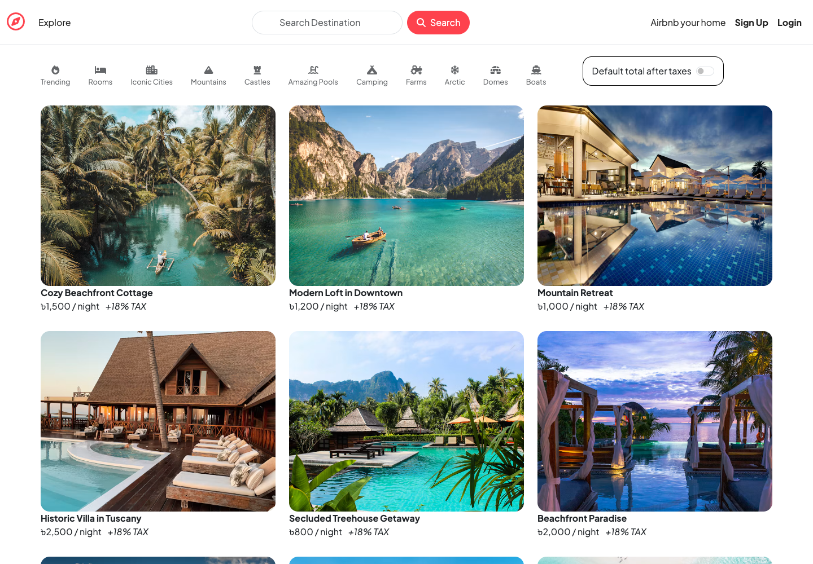
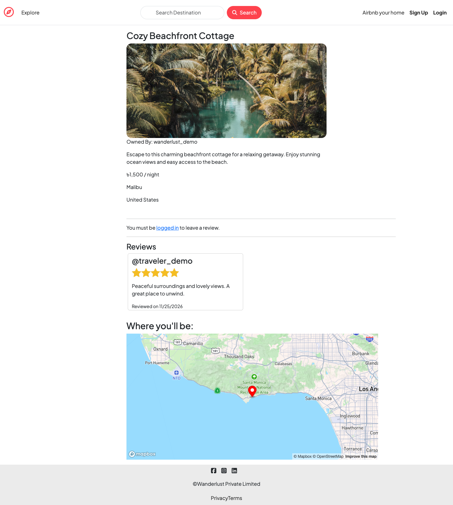
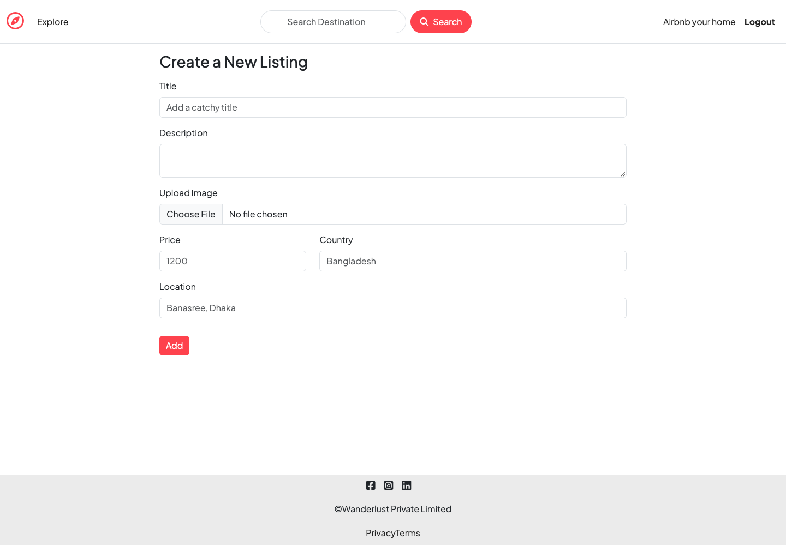
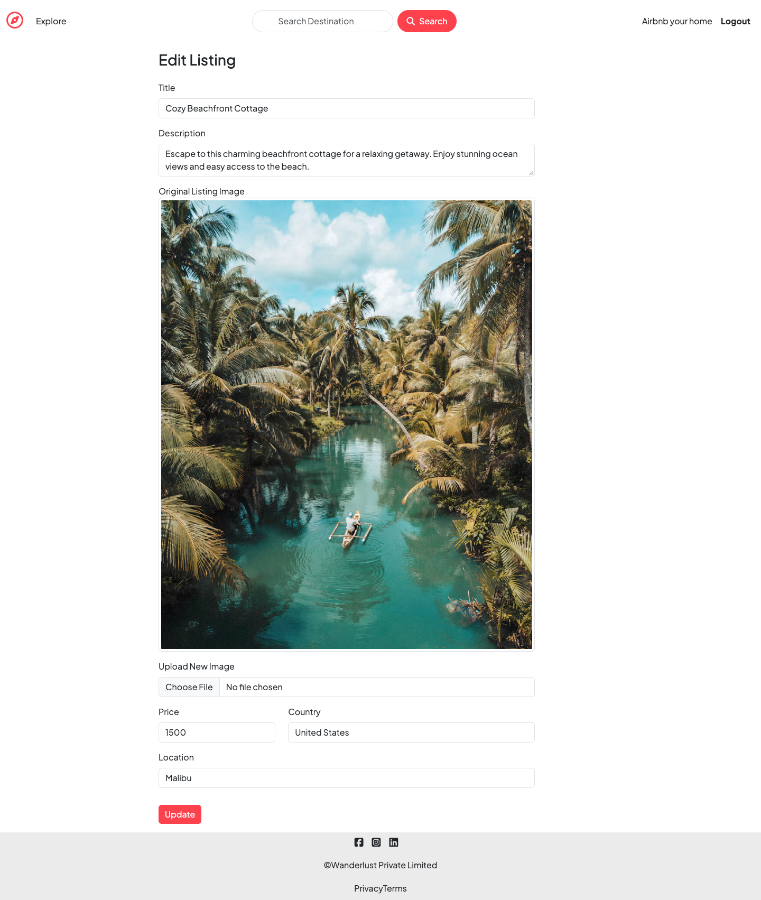
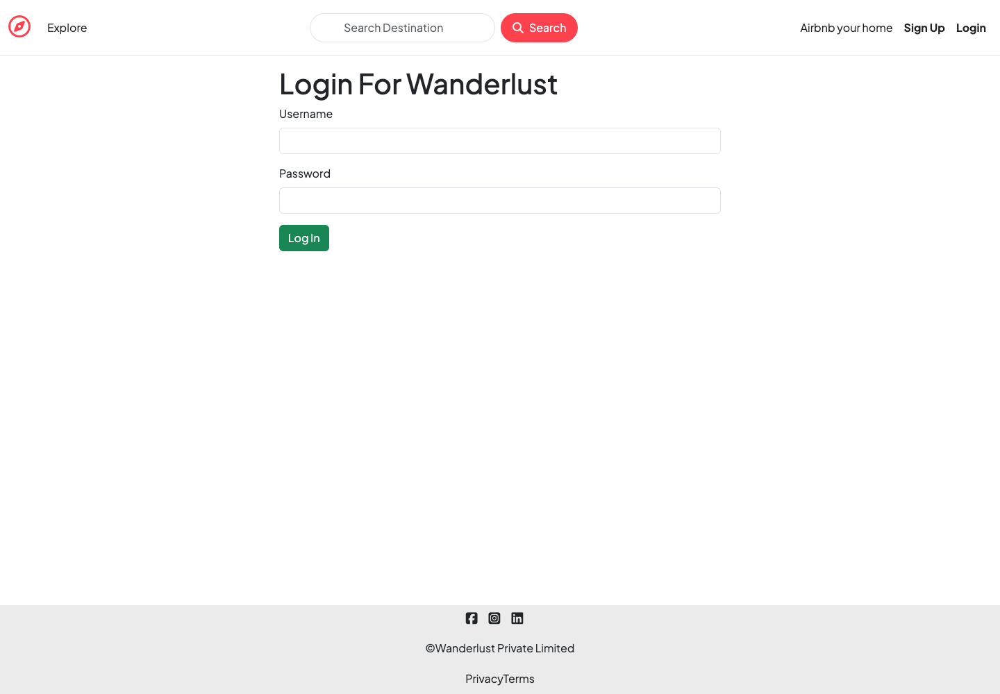
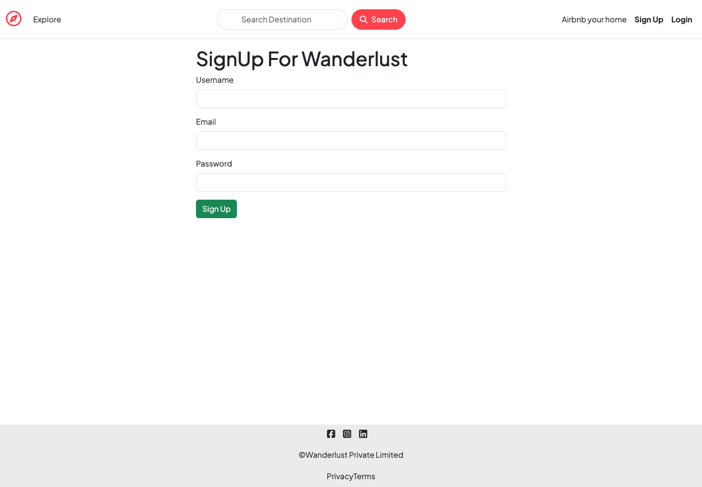

# Wanderlust

An Airbnb-inspired rental listing app built with Node.js, Express, MongoDB, and EJS. Browse stays, view locations on a map, publish properties with photos, and leave reviews with star ratings.



## Features

- Signup, login, and logout with Passport local authentication.
- Property details with photos, descriptions, locations, and nightly prices in Bangladeshi taka (৳).
- Create, edit, and delete listings, with ownership checks for changes.
- Image uploads stored in Cloudinary through Multer.
- Mapbox maps and geocoding for listing locations.
- Reviews with 1–5 star ratings; authors can delete their own reviews.
- MongoDB-backed sessions, flash messages, and Joi request validation.

## Screenshots

These screenshots show the running app with the sample listings in `init/data.js`, a local demo owner, and a sample review. Desktop captures use a 1440 × 1000 viewport; longer forms and detail pages include the full page.

### Listing details, reviews, and map



### Create a listing



### Edit a listing



### Login



### Signup



## Tech stack

| Layer | Technologies |
| --- | --- |
| Server | Node.js, Express 5, EJS, EJS Mate |
| Database | MongoDB, Mongoose, connect-mongo |
| Authentication | Passport, passport-local-mongoose, express-session |
| Uploads and maps | Multer, Cloudinary, Mapbox |
| Interface | Bootstrap 5, Font Awesome, custom CSS and JavaScript |
| Validation and feedback | Joi, connect-flash |

## Run locally

### 1. Install prerequisites and dependencies

Use Node.js **24.2.0**, as specified in `package.json`, and a running MongoDB instance. A Mapbox public access token is required at startup. Cloudinary credentials are needed to upload listing photos.

```bash
git clone https://github.com/RezuanMustafaHasan/Wanderlust.git
cd Wanderlust
npm ci
cp .env.example .env
```

### 2. Configure `.env`

| Variable | Purpose |
| --- | --- |
| `ATLASDB_URL` | MongoDB URI for both application data and sessions. The example uses `mongodb://127.0.0.1:27017/wanderlust_demo`; an Atlas URI also works. |
| `SECRET` | A long, random session secret. |
| `PORT` | HTTP port; defaults to `8080`. |
| `MAP_TOKEN` | Mapbox public access token for maps and geocoding. |
| `CLOUD_NAME` | Cloudinary cloud name. |
| `CLOUD_API_KEY` | Cloudinary API key. |
| `CLOUD_API_SECRET` | Cloudinary API secret. |

Generate a session secret and paste it into `.env`:

```bash
node -e "console.log(require('node:crypto').randomBytes(32).toString('hex'))"
```

The `.env` file is ignored by Git. The browser receives the Mapbox public token to render maps; Cloudinary secrets stay on the server.

### 3. Optionally load sample listings

With MongoDB running at `127.0.0.1:27017`, seed the dedicated local demo database:

```bash
DEMO_PASSWORD='choose-a-demo-password-at-least-12-characters' node scripts/seed-demo.js
```

The script creates **29 listings** and an owner named `wanderlust_demo`. Log in with that username and the password you supplied to access the create and edit forms. It always targets the local `wanderlust_demo` database, ignores any Atlas URI in `.env`, and refuses to seed a database that already contains documents. It does not clear existing data.

Set `ATLASDB_URL=mongodb://127.0.0.1:27017/wanderlust_demo` in `.env` to browse the seeded listings. You can also start with an empty database, sign up, and create your own listings after configuring Cloudinary and Mapbox.

### 4. Start the server

```bash
npm start
```

Open [http://localhost:8080/listings](http://localhost:8080/listings). The listings page is the app's main screen; `/` currently returns a plain-text greeting.

If another project uses port 8080:

```bash
PORT=8082 npm start
```

Then open [http://localhost:8082/listings](http://localhost:8082/listings).

## Main pages

| Route | Access |
| --- | --- |
| `/listings` | Public listing gallery |
| `/listings/:id` | Public property details, reviews, and map |
| `/signup` | Create an account |
| `/login` | Log in |
| `/listings/new` | Logged-in users |
| `/listings/:id/edit` | Listing owner only |

## Project structure

```text
controllers/       Listing, review, and account request handlers
models/            Mongoose listing, review, and user schemas
routes/            Express listing, review, and authentication routes
views/             EJS pages, layout, and shared includes
public/            Stylesheets and browser JavaScript
init/data.js       Sample listing data
scripts/seed-demo.js  Non-destructive local demo seeder
docs/screenshots/  Screenshots of the running app
middlewares.js     Authentication, ownership, and validation checks
schema.js          Joi request schemas
cloudConfig.js     Cloudinary upload configuration
index.js           Express application and database/session setup
```

## Current scope and checks

This project implements listings, accounts, and reviews. Booking and payment flows are not implemented. The destination search and category icons are currently interface elements without filtering logic; the tax switch toggles the tax label. The footer's privacy and terms pages are not implemented.

Browser smoke checks covered the listing gallery, registration, login failure feedback, logout, protected-page redirects, review submission, Mapbox rendering, owner forms, and updating a listing without replacing its image. Cloudinary uploads were not exercised during the screenshot capture. `npm test` is currently a placeholder and exits with an error; there is no automated test suite.

The legacy `init/index.js` clears the configured listings collection and uses a hardcoded owner ID. Use `scripts/seed-demo.js` for local sample data.
